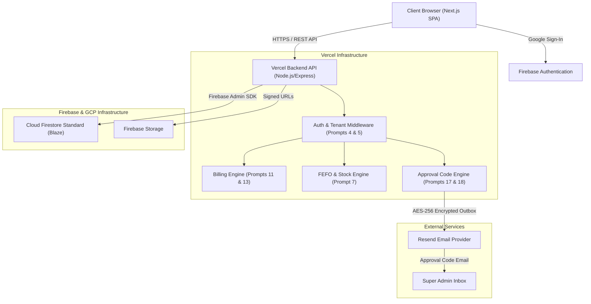
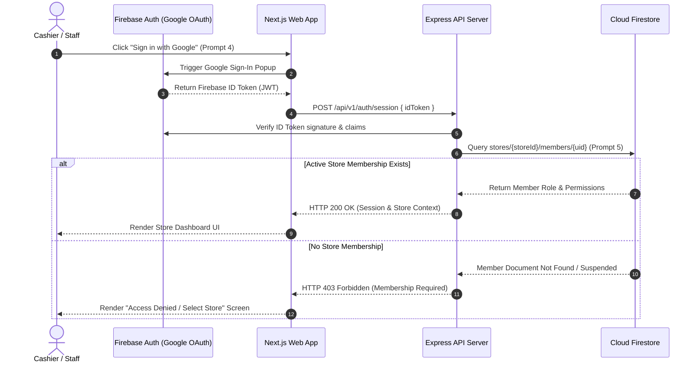
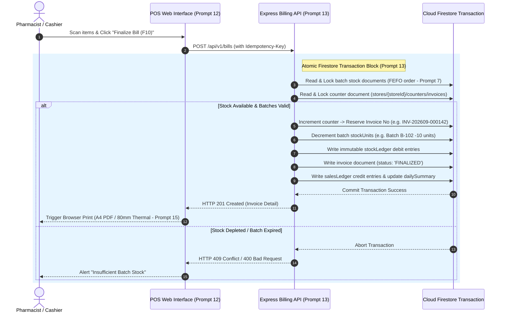
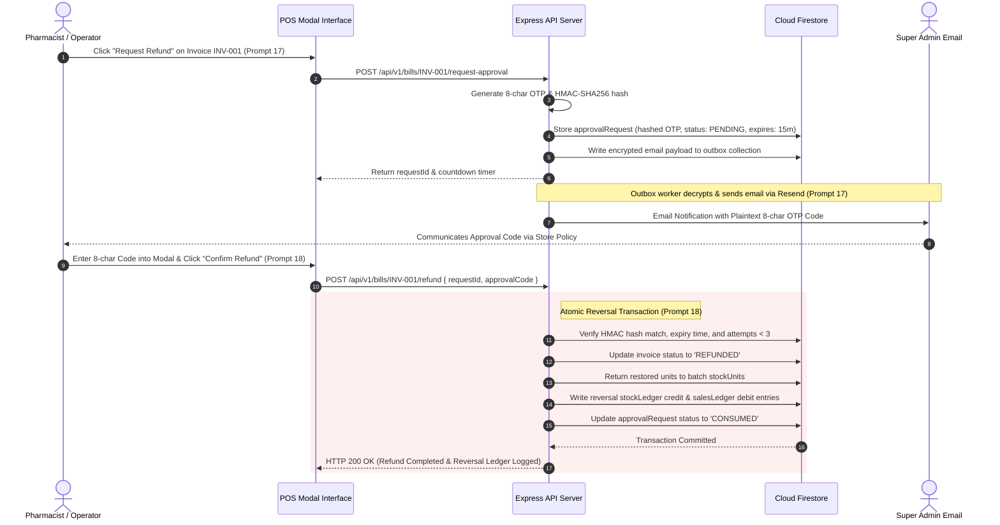
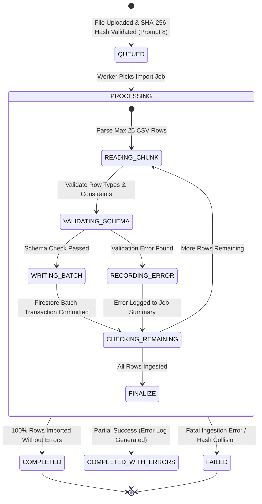
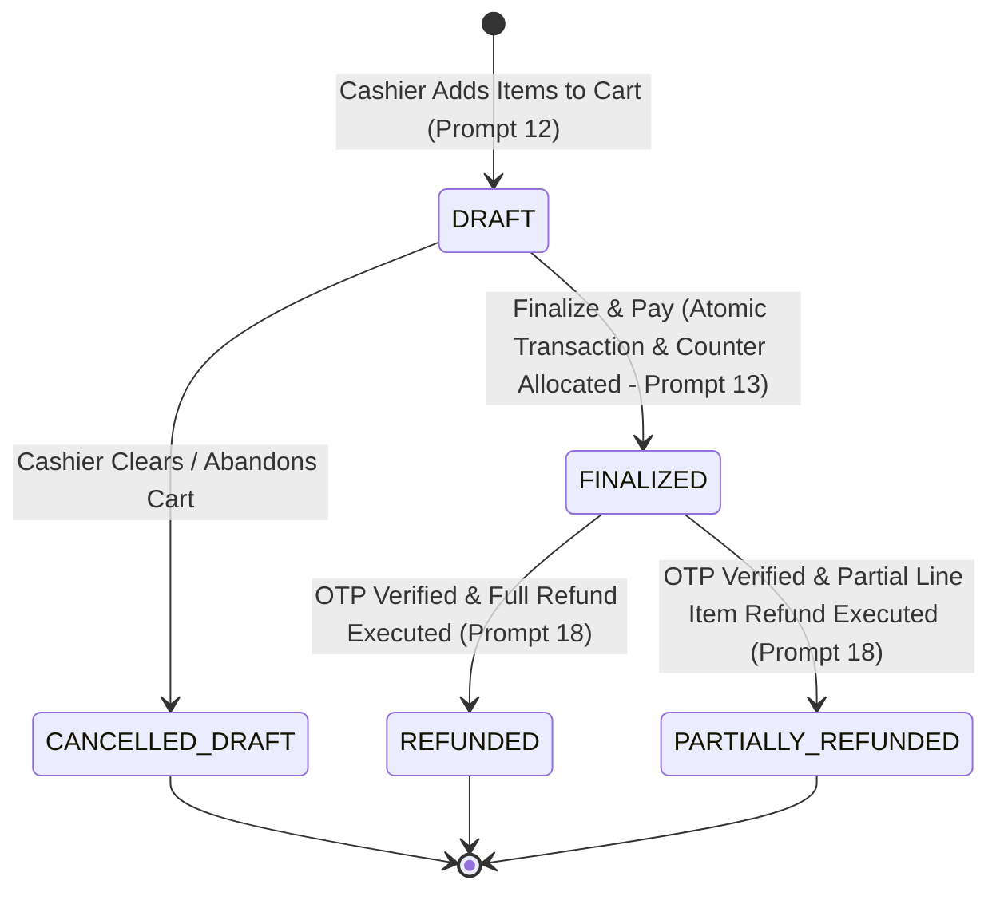

# System Architecture & Workflow Mermaid Diagrams

This document collects all 6 required compact Mermaid visual workflow and architectural diagrams for the Pharmacy AI Agent system in accordance with Pack 1.2 specifications and Prompt 1A corrections.

---

## 1. Runtime Architecture Topology

---

## 2. Authentication & Store Membership Flow

---

## 3. Bill-Finalization Transaction Sequence

---

## 4. Cancellation / Refund Approval & Reversal Sequence

---

## 5. Dynamic CSV Batch Import State Machine

---

## 6. Bill Status Lifecycle State Machine

